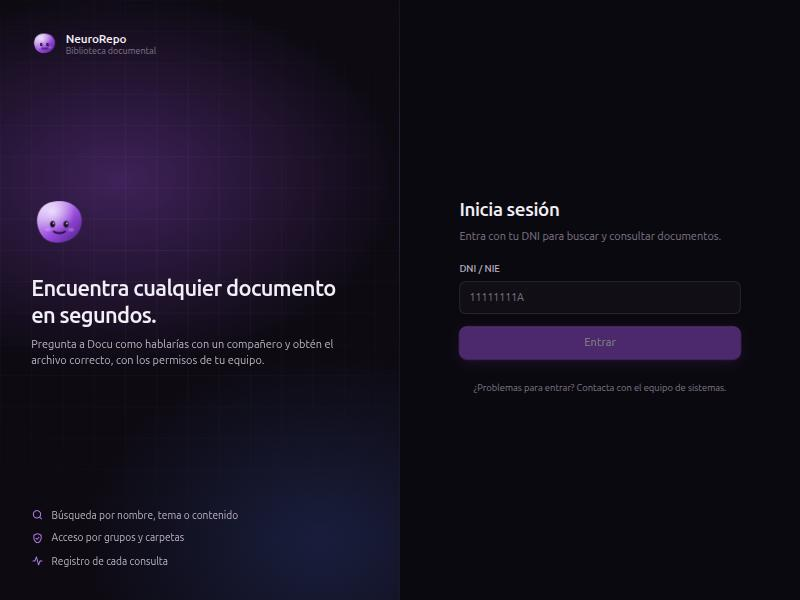
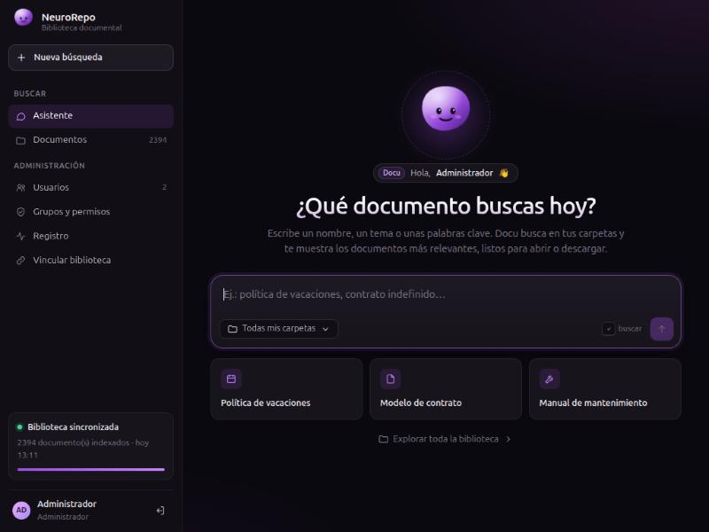
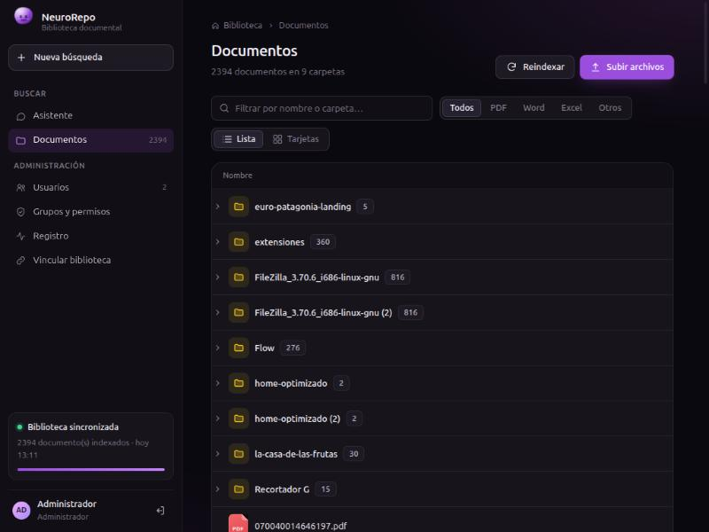
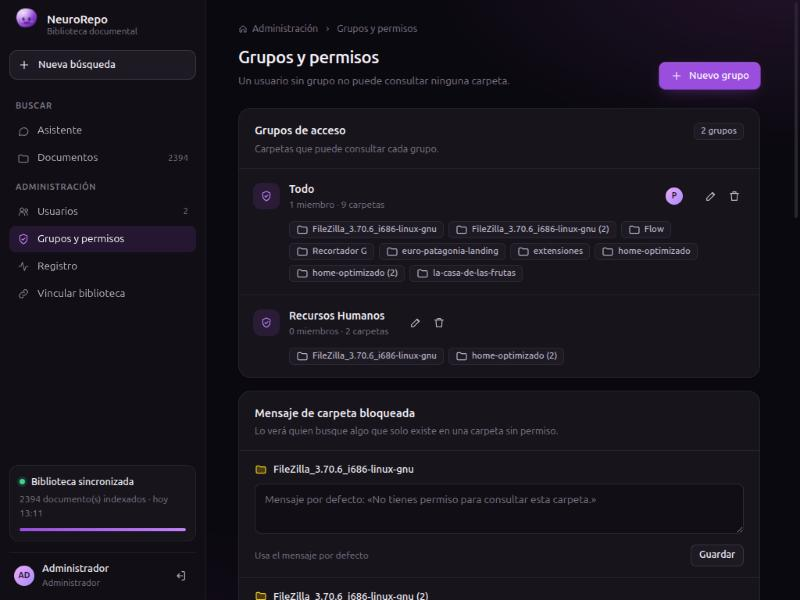

# NeuroRepo — Biblioteca de documentos con IA

Gestor documental (parecido a Alfresco Community, con IA) para la documentación del trabajo. Interfaz
tipo ChatGPT: en el chat se **busca** por coincidencia de texto (la IA solo entra como respaldo si la
búsqueda no encuentra nada razonable, y nunca redacta la respuesta) y los resultados se pueden **ver**
en línea (PDF/imágenes) o **descargar**. También hay un explorador de carpetas (`Documentos`) para
navegar todo lo indexado, en lista o en tarjetas.

Los documentos viven en una carpeta normal del disco (fuera de la app); Mongo solo guarda el índice
(metadatos + texto extraído), nunca el archivo en sí.

<p align="center">
  
  
</p>
<p align="center">
  
  
</p>

Roles:
- **Usuario normal**: se da de alta con **nombre + DNI, sin contraseña**; entra escribiendo solo su DNI.
  Solo puede buscar/consultar las carpetas que le permita su grupo (sin grupo, no ve ninguna).
- **admin**: mantiene contraseña. Gestiona usuarios, grupos (qué carpetas ve cada uno) y la biblioteca
  activa («Vincular biblioteca»: elegir carpeta, crear/renombrar/borrar carpetas, subir archivos).

Nada depende de APIs de pago: Mongo, Ollama y el almacenamiento son todos locales.

## Puesta en marcha rápida (Docker)
Requisito: Docker Desktop (o Docker Engine + el plugin `compose` en Linux).

1. Crea un archivo `.env` en la raíz:
   ```
   DOCS_HOST_PATH=./documentos-prueba        # carpeta del host con los documentos
   BOOTSTRAP_ADMIN_NAME=Administrador
   BOOTSTRAP_ADMIN_DNI=00000000A
   BOOTSTRAP_ADMIN_PASSWORD=pon-aqui-una-contraseña
   OLLAMA_MODEL=qwen2.5:3b
   ```
2. Arranca:
   ```bash
   docker compose -f docker-compose.yml -f docker-compose.local.yml up -d --build
   ```
3. Abre http://localhost:4000 y entra con el DNI y la contraseña del admin (así se crea esa primera
   cuenta). La primera vez descarga el modelo de IA (~2 GB) y tarda unos minutos.

### En Windows, sin usar la terminal
Si vas a instalarlo en un ordenador con Windows para compartirlo por la red local con compañeros, usa
el instalador incluido. No hace falta tener ya el proyecto descargado ni saber de Git ni de Docker:

1. Descarga solo estos dos archivos (botón derecho → «Guardar enlace como…») en cualquier carpeta:
   [`Instalar.bat`](https://raw.githubusercontent.com/Smith-Develop/NeuroRepo/main/Instalar.bat) y
   [`instalar.ps1`](https://raw.githubusercontent.com/Smith-Develop/NeuroRepo/main/instalar.ps1)
   (o, si ya tienes clonado el repositorio entero, úsalos directamente desde ahí).
2. Haz doble clic en `Instalar.bat`.

A partir de ahí el instalador hace todo solo, sin más intervención que responder lo que pregunta:
- Si todavía no tiene el proyecto al lado (es el caso del paso 1), **descarga NeuroRepo entero desde
  GitHub** él mismo (con `git clone` si hay Git instalado, o un `.zip` si no) en la carpeta que le
  digas (por defecto `%USERPROFILE%\NeuroRepo`), y continúa la instalación ya desde esa copia.
- Comprueba si hace falta Docker Desktop (lo instala solo si no está, reiniciando el equipo si es
  necesario — al volver a iniciar sesión el propio instalador continúa solo donde lo dejó).
- Pide por pantalla la configuración (nombre/DNI/contraseña del admin, carpeta de documentos, modelo
  de IA, intervalo de reindexado) y la guarda en `.env`.
- Abre el puerto 4000 en el Firewall de Windows y levanta todo con `docker compose`.
- Al terminar muestra la URL para compartir con el resto del equipo en la misma red
  (`http://<ip-del-pc>:4000`).

Si ya tienes el proyecto entero descargado (por ejemplo, lo clonaste con Git), el instalador detecta
que ya está ahí y se salta el paso de descarga.

## Desarrollo (sin Docker)
1. Instala **Ollama** (https://ollama.com/download) y el modelo:
   ```bash
   ollama pull qwen2.5:3b
   ```
2. Ten **MongoDB** en marcha (local o Atlas gratis).
3. Backend:
   ```bash
   cd server && cp .env.example .env   # ajusta LIBRARY_ROOT a una carpeta local de prueba
   npm install && npm run dev
   ```
4. Frontend (otra terminal):
   ```bash
   cd client && npm install && npm run dev
   ```
   Abre http://localhost:5173 (Vite hace proxy de `/api` al backend en :4000).

## Elegir modelo de IA
Variable `OLLAMA_MODEL` (en `server/.env` o al lanzar `docker compose`). La IA solo se usa como
respaldo de la búsqueda por texto (reformula la pregunta en palabras clave), así que un modelo pequeño
suele bastar:
| Modelo | RAM aprox. | Notas |
|---|---|---|
| `qwen2.5:3b` (por defecto) | 4 GB | Rápido, suficiente para sugerir palabras clave |
| `qwen2.5:7b` | 8 GB | Algo más preciso; más lento sin GPU |

Con GPU NVIDIA es mucho más rápido: descomenta el bloque `deploy` en `docker-compose.yml`.

## Estructura
Ver `CLAUDE.md` para el detalle de archivos, rutas y decisiones. Resumen rápido:
- `server/src/library.js` / `indexer.js` – biblioteca activa, escaneo e indexado de documentos.
- `server/src/search.js` – búsqueda por texto (Mongo `$text` + reordenado). `ai.js` – respaldo de la IA
  (solo palabras clave, nunca redacta respuestas).
- `server/src/auth.js` / `authRoutes.js` – login (DNI, o DNI+contraseña para el admin), usuarios, grupos.
- `server/src/models.js` – Mongoose: `Document`, `Group`, `FolderConfig`, `User`, `Session`.
- `client/src/Chat.jsx` – búsqueda tipo chat · `Explorer.jsx` – árbol de carpetas (lista/tarjetas) ·
  `LibraryPicker.jsx` – «Vincular biblioteca» · `Users.jsx`/`Groups.jsx` – paneles de admin.
- `instalar.ps1` / `Instalar.bat` – instalador para Windows, capaz de descargar el proyecto desde
  GitHub por sí solo (ver sección de arriba).
